<p align="center">
  <picture>
    <source media="(prefers-color-scheme: dark)" srcset="./assets/profile-dark.svg" />
    <source media="(prefers-color-scheme: light)" srcset="./assets/profile-light.svg" />
    
  </picture>
</p>

<p align="center">
  <a href="https://orcid.org/0009-0005-5248-0063">
    
  </a>
  
  
  <a href="https://doi.org/10.2196/84110">
    
  </a>
  
</p>

### ✦ Highlights

- **Quantitative Research** — **A&R Capital · Research Team** (`2022–now`), focusing on systematic research, high-reliability engineering, and agentic developer workflows.
- **Competitive Programming** — **2019 ICPC Asia Taipei-Hsinchu Regional (5th Place)** & **2019 ICPC Asia Seoul Regional (7th Place)**.
- **Research & Formal Verification**
  - *Multimodal Depression Detection Through Conversational Interactions with an Emotion-Aware Social Robot: Pilot Study* (**DEPRESAR-Fusion**), *JMIR Formative Research* (2026) — [DOI: 10.2196/84110](https://doi.org/10.2196/84110)
  - Formal math contributor to [`open-goat/pequalnp-proofs`](https://github.com/open-goat/pequalnp-proofs) in **Lean 4** ([PR #6303](https://github.com/open-goat/pequalnp-proofs/pull/6303), [PR #7143](https://github.com/open-goat/pequalnp-proofs/pull/7143), [PR #8335](https://github.com/open-goat/pequalnp-proofs/pull/8335)).
- **Selected Public Code** — [`OthelloZero`](https://github.com/puyuliao/OthelloZero) · [`AlphaZero_Gomoku`](https://github.com/puyuliao/AlphaZero_Gomoku) · [`Reverberator`](https://github.com/puyuliao/Reverberator) · [`NAPCodebook`](https://github.com/puyuliao/NAPCodebook)

<details>
<summary>✦ Plain-Text Hagemi ASCII Card</summary>

```text
             ==++#                     puyuliao@antigravity
     ==      =+        ===-*           ----------------------------------------
    *:-===+++++++===++=-::.+           Name        : Pu-Yu Liao
     -.:=========+==--=:.:-++          ORCID       : 0009-0005-5248-0063
     +.:-===============::=+=+*        Role        : A&R Capital · Research Team (2022-now)
   #*++======--=========-:-=+=+        Education   : M.S. CSIE, National Taiwan University
   *=+============-=====+-+*++*        ICPC 2019   : Asia Taipei-Hsinchu · 5th Place
  *+++====-.-=--=:.:======+++*         ICPC 2019   : Asia Seoul · 7th Place
    **========---.-+*++===+==+*        Vibe        : Antigravity CLI Lover (w/ Hagemi)
     *+==+==+=....:--:===++===+=       Formal Math : P vs NP (Lean 4) · 3 Merged PRs
    +++*==-..........===++=====++      Paper       : JMIR Formative Research '26 (DEPRESAR)
  ++===++-++=-==-=+=+*==+*+==--===-    Stack       : C++ · Python · Lean 4 · Linux · tmux
==+=-==+==+-:+*=-+#-.-+==++=----=+==
=----=+=++===**--+*+===++-+===----==
=::-+=++=.:*#+-::-+*%+..=++===-==:-+
```

</details>
